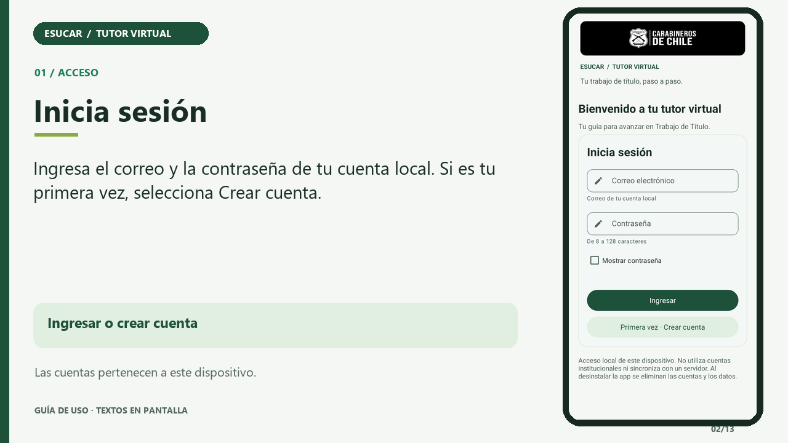

# Tutor Virtual ESUCAR

Aplicación móvil Android (**Kotlin + Android Views + Material 3**) que funciona como tutor virtual para Trabajo de Título I, II y III de la Escuela de Suboficiales de Carabineros de Chile (ESUCAR).

Guía al estudiante en la construcción de su trabajo, centraliza pautas y permite registrar avances y resolver dudas frecuentes, **incluso sin conexión**. Incluye revisión docente de demostración, aprobación de hitos y retroalimentación.

> Proyecto académico **DSY1105 · Desarrollo de Aplicaciones Móviles**, Duoc UC · Evaluación Parcial 2 · Versión **1.3.0**. No es una aplicación oficial de la institución.

## Integrantes

| Nombre |
|---|
| Ignacio Moya |
| Bryan Burgos |
| Felipe Rios |

## Video explicativo

[](docs/video/VideoESUCAR.mp4)

[**Ver o descargar VideoESUCAR.mp4**](docs/video/VideoESUCAR.mp4)

Tutorial de **78 segundos**, resolución **1280 × 720 (720p)**, formato **MP4/H.264** y peso **1,29 MB**. Presenta capturas renderizadas de la app con textos explicativos, sin locución.

Recorrido: registro e ingreso → inicio → guía → lista de avance y notas → registro de envío → revisión docente → consultas y recordatorios.

El archivo está incluido en el repositorio. [Guion](docs/video/GuionVideoESUCAR.txt) · [Ficha técnica](docs/video/FichaVideoESUCAR.txt).

## Funcionalidades implementadas

### Estudiante

- **Registro e ingreso:** validación por campo, confirmación de contraseña, mostrar/ocultar contraseña y sesión recordada.
- **Cuentas locales:** contraseñas derivadas con PBKDF2 y sal aleatoria; avances separados por cuenta y cierre de sesión sin borrar los datos.
- **Inicio:** hitos aprobados, próxima etapa, fecha de entrega y advertencias de vencimiento.
- **Guía metodológica:** seis etapas, desde planteamiento hasta informe final, distribuidas en Trabajo de Título I, II y III.
- **Etapas:** orientación, formato, criterios de revisión, checklist persistente y notas con guardado automático válido.
- **Documentos:** vincular y abrir archivos con el selector de Android.
- **Entregas:** Por iniciar → En desarrollo → Enviado → Aprobado. Enviado registra un estado local; no transmite archivos al profesor.
- **Consultas:** 15 FAQ, búsqueda sin distinguir tildes/mayúsculas y filtro por categoría.
- **Calendario:** abrir un borrador de evento de entrega para que el usuario lo confirme.
- **Recordatorios:** alarmas y notificaciones locales con permiso, prueba de aviso y reprogramación tras reinicio.
- **Contenidos:** guías y avances sin conexión; actualización opcional de FAQ desde JSON HTTPS.

### Profesor guía (demostración)

- Cambiar a docente desde **Ajustes**, dentro de la cuenta local.
- Revisar un hito enviado, escribir retroalimentación y aprobar o solicitar correcciones.
- Editar fecha, formato requerido y criterios de revisión de cada etapa.
- Consultar el progreso actualizado después de la revisión.

El cambio de perfil es una simulación académica, no una autorización institucional. No existen cuentas docentes remotas ni un servidor multiusuario.

### Requisitos de la evaluación cubiertos

| Requisito | Dónde |
|---|---|
| Diseño visual Material 3 | Tema Material 3, `ui/theme/`, botones, tarjetas, campos y navegación Material |
| Formularios validados con iconos y mensajes | Login/registro, perfil, fecha, formato, criterios, notas, retroalimentación y URL |
| Validaciones desacopladas | `domain/validacion/`, ViewModels y pruebas en `app/src/test/` |
| Navegación funcional | `ui/navegacion/`, barra inferior y botón Atrás |
| Gestión de estado MVVM | `TutorViewModel`, `LoginViewModel` y `StateFlow` |
| Persistencia local | SharedPreferences: cuentas, sesión, avances y contenido |
| Recursos nativos (3) | Documentos, notificaciones/AlarmManager y calendario (`nativo/`) |
| Animaciones | Entrada de pantalla, barras de progreso, respuesta de errores e indicadores de carga |

[Detalle de la rúbrica](docs/RUBRICA.md) · [Diseño Material 3 e identidad visual](docs/DISENO_MATERIAL3.md).

## Cómo ejecutar

### Requisitos

- Android Studio compatible con **AGP 9.2.1** y **Gradle 9.4.1** (Wrapper incluido).
- **JDK 17 o superior**, probado con JDK 21.
- SDK Platform **37** y Build Tools **36.0.0**.
- Teléfono o emulador **Android 8.0/API 26** o superior. Recomendado API 33+ para probar el permiso de notificaciones.

### Pasos

1. Clona el repositorio:

   ```bash
   git clone https://github.com/bburgosvader/ESUCAR.git
   ```

2. Abre la carpeta `ESUCAR` con **Android Studio → File → Open**.
3. Espera la sincronización de Gradle y configura la ruta del SDK si se solicita.
4. Selecciona el dispositivo y ejecuta **app → Run**.

En PowerShell:

```powershell
.\gradlew.bat assembleDebug testDebugUnitTest lintDebug
```

En macOS/Linux:

```bash
chmod +x gradlew
./gradlew assembleDebug testDebugUnitTest lintDebug
```

APK: `app/build/outputs/apk/debug/app-debug.apk`. La primera sincronización y las primeras pruebas necesitan internet para descargar dependencias y Android simulado de Robolectric.

### Datos para probar

- No hay credenciales predeterminadas. Selecciona **Primera vez · Crear cuenta** y registra nombre, correo y contraseña de **8–128 caracteres**.
- Puedes utilizar un correo de prueba como `estudiante@example.org` y una contraseña creada por ti. La cuenta pertenece a ese dispositivo.
- La primera cuenta recupera una sola vez el avance de versiones anteriores; las siguientes tienen datos separados.
- Flujo completo: comenzar una etapa → completar checklist → agregar notas/documento → marcar enviado → cambiar a docente demo → aprobar/devolver → regresar a estudiante.
- Para actualizar FAQ, guarda esta fuente en Ajustes y pulsa **Actualizar ahora**:

  ```text
  https://raw.githubusercontent.com/bburgosvader/ESUCAR/main/docs/faq-ejemplo.json
  ```

> Las guías, pautas y fechas iniciales son de ejemplo. Deben validarse con el docente. El estado Enviado no reemplaza el canal de entrega de la asignatura.

## Arquitectura

Patrón **MVVM** con separación de responsabilidades e inyección manual:

```text
UI (Android Views/Material 3) → ViewModel → Repository → SharedPreferences
             ↑                  │
             └──── StateFlow ───┘
```

```text
app/src/main/java/cl/esucar/tutor/
├── MainActivity.kt          Punto de entrada Android
├── TutorApp.kt              Application y contenedor
├── di/AppContainer.kt       Inyección manual de dependencias
├── domain/
│   ├── model/              Modelos y reglas de estados
│   ├── repository/         Contrato TutorStore
│   ├── validacion/         Formularios y credenciales
│   └── seguridad/          Derivación/verificación de contraseñas
├── data/
│   ├── local/              Catálogo metodológico y FAQ
│   ├── repository/         Autenticación, sesión y persistencia
│   └── remote/             HTTPS y JobScheduler
├── nativo/                 Documentos, calendario y recordatorios
└── ui/
    ├── auth/               Ingreso y registro
    ├── components/         Campos, tarjetas, animaciones e identidad
    ├── estudiante/         Inicio, guía, etapa y consultas
    ├── profesor/           Revisión y edición de pauta/fecha
    ├── perfil/             Cuenta, ajustes y cierre de sesión
    ├── navegacion/         Host, navegación y estado académico
    └── theme/              Paleta institucional de referencia
```

**Tecnologías:** Kotlin integrado en AGP 9.2.1 · Android Views · Material Components 1.14.0 con tema Material 3 · AndroidX Activity/Lifecycle/ViewModel · StateFlow/Coroutines · SharedPreferences · AlarmManager · JobScheduler · JUnit 4 · Robolectric 4.17.

## Documentación

| Documento | Para qué sirve |
|---|---|
| [Arquitectura](docs/ARQUITECTURA.md) | Capas, paquetes, estado y dependencias |
| [Rúbrica](docs/RUBRICA.md) | Evidencias por indicador y pendientes académicos |
| [Planificación](docs/PLANIFICACION.md) | Seguimiento de tareas y equipo |
| [Pruebas](docs/PRUEBAS.md) | Cobertura automatizada y revisión manual |
| [Acceso local](docs/LOGIN.md) | Registro, sesión, aislamiento y alcance |
| [Diseño Material 3](docs/DISENO_MATERIAL3.md) | Siete requisitos, colores y origen del logo |
| [Video explicativo](docs/video/VideoESUCAR.mp4) | Tutorial de uso de 78 segundos |

## Planificación y verificación

**Tablero del equipo:** [Trello ESUCAR](https://trello.com/b/wgburVCk/esucar).

El proyecto compila, cuenta con **36 pruebas aprobadas** y **cero errores de lint**. Se revisaron capturas de Android simulado. Quedan por validar en hardware los permisos y servicios nativos, TalkBack y el comportamiento en teléfono/tableta antes de la defensa.

El tablero distingue implementación verificada, pruebas pendientes en dispositivo y gestiones de entrega. La participación real de los tres integrantes debe evidenciarse con sus aportes y revisiones.

## Contexto del caso

Caso académico DSY1105 del CITT Duoc UC para acompañar el Trabajo de Título en ESUCAR. Busca reducir consultas repetitivas y mejorar el seguimiento de entregables con una herramienta móvil de acceso continuo.

Los datos viven en el dispositivo, sin conexión con servidores institucionales. No hay sincronización de avances entre teléfonos ni calificaciones oficiales. Los recordatorios son aproximados y Android puede posponerlos para ahorrar batería. Desinstalar elimina las cuentas y sus datos.
