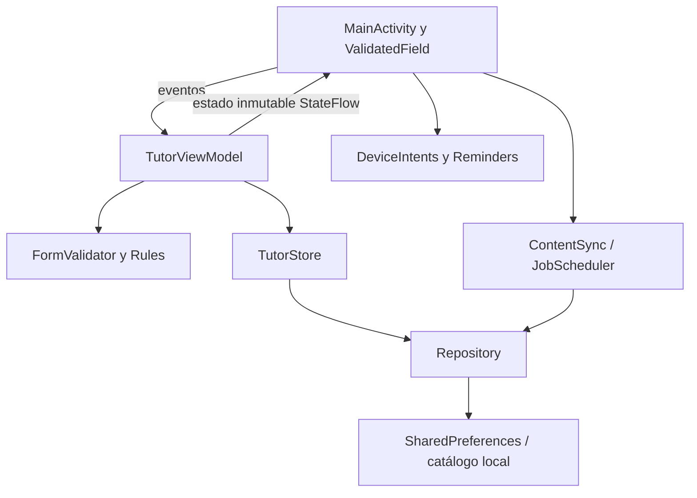

# Arquitectura MVVM



- **Vista:** construye controles, recoge entradas y observa estado solo cuando está iniciada. Se limita a representar errores calculados por el ViewModel. Los recursos Android de corta duración se manejan desde la Activity y la capa `nativo`.
- **ViewModel:** mantiene borradores, errores, navegación, progreso y operaciones; no guarda referencias a Activity ni a vistas. Rechaza modificaciones incompatibles con el rol y el estado de la entrega. `viewModelScope` controla la actualización de FAQ.
- **Dominio:** modelos, contrato de datos y validadores sin dependencia de Android. Las pruebas usan `MemoryStore` para verificar decisiones sin almacenamiento real.
- **Datos:** `Repository` implementa `TutorStore`. Mantiene las claves `tutor_v1` para que una actualización desde 1.0 conserve notas, estados y configuración. Es adecuado para un MVP de seis hitos; una versión multiusuario requeriría otro almacenamiento y autorización real.
- **Recursos del dispositivo:** documentos por Storage Access Framework, notificaciones por canal con permisos y calendario mediante un Intent que el usuario confirma. No se pide acceso global de lectura/escritura a almacenamiento ni calendario.

## Conservación de estado

El ViewModel sobrevive a recreaciones de la Activity. La Activity guarda navegación y borradores en `onSaveInstanceState` para restaurarlos después de recreación de proceso. Los datos válidos se persisten en SharedPreferences. Los borradores inválidos no reemplazan datos válidos y pueden corregirse al regresar al formulario.

## Animaciones

`UiAnimations` concentra entrada de pantalla (180 ms), corrección visual de errores (220 ms) y transición de barras de progreso (350 ms). Comprueba `ValueAnimator.areAnimatorsEnabled()` antes de ejecutarlas. No agrega esperas artificiales ni bloquea botones mientras anima.

Referencias técnicas: [capa de UI de Android](https://developer.android.com/topic/architecture/ui-layer), [intents comunes](https://developer.android.com/guide/components/intents-common), [pruebas con Robolectric](https://robolectric.org/getting-started/).

## Organización por paquetes

Se reorganizó tomando como referencia la separación de responsabilidades del [proyecto del compañero](https://github.com/rfelipe715/tutor-app-esucar/tree/main/app/src/main/java/cl/duoc/tutorvirtual), conservando las funciones propias del MVP. No se agregaron paquetes vacíos para simular funcionalidades.

```text
MainActivity.kt              Punto de entrada (6 líneas)
TutorApp.kt                  Inicio y contenedor de la aplicación
data/
  local/Catalog.kt           Guías y FAQ incluidas
  repository/Repository.kt  Persistencia local
  remote/ContentSyncService.kt  Actualización HTTPS
di/AppContainer.kt          Construcción e inyección de dependencias
domain/
  model/Domain.kt            Modelos y reglas de estados
  repository/TutorStore.kt   Contrato del repositorio
  validacion/FormValidator.kt  Validaciones puras
nativo/                     Documentos, calendario y notificaciones
ui/
  components/               Campos, controles y animaciones compartidas
  estudiante/               InicioScreen, GuiaScreen, EtapaScreen, AyudaScreen
  profesor/RevisionScreen.kt  Formulario y revisión docente
  perfil/PerfilScreen.kt     Perfil y ajustes
  navegacion/               Host de pantallas, navegación y ViewModel
  theme/TutorTheme.kt        Paleta de colores
```

`TutorApp` posee `AppContainer`, que construye el repositorio e inyecta `TutorStore` al ViewModel mediante una fábrica. `MainActivity` hereda del host de ciclo de vida; el contenido de cada pantalla está en su archivo, implementado como función de extensión del host. Los componentes compartidos están en `ui/components` y el formulario docente en `ui/profesor`.
